# Operating Systems Lab Record — VNRVJIET

A GitHub-ready repository containing the Operating Systems laboratory record programs, algorithms, and output/test-case snippets from the supplied OS record.

**Roll No.:** `25071A6230`  
**Laboratory:** Operating Systems  
**Institution:** VNRVJIET  
**Language:** C  

> **Source preservation:** The repository is organized from the supplied OS record. Program logic, terminology, experiment numbering, and record output snippets are preserved rather than silently replaced with a different implementation.

## Repository Structure

```text
OS-Lab-Record/
├── README.md
├── .gitignore
├── record/
│   ├── os_record.pdf
│   └── os_record.docx
└── experiments/
    ├── 01_cpu_scheduling/
    │   ├── README.md
    │   ├── src/
    │   └── outputs/
    ├── 02_priority_round_robin/
    │   ├── README.md
    │   ├── src/
    │   └── outputs/
    ├── 03_banker_scheduling_analysis/
    │   ├── README.md
    │   ├── src/
    │   └── outputs/
    ├── 04_memory_allocation/
    │   ├── README.md
    │   ├── src/
    │   └── outputs/
    ├── 05_paging/
    │   ├── README.md
    │   ├── src/
    │   └── outputs/
    ├── 07_frame_allocation/
    │   ├── README.md
    │   ├── src/
    │   └── outputs/
    ├── 08_disk_scheduling/
    │   ├── README.md
    │   ├── src/
    │   └── outputs/
    └── 09_disk_scheduling/
        ├── README.md
        ├── src/
        └── outputs/
```

## Experiments Included

| Experiment | Topic | Programs |
|---|---|---:|
| 1 | FCFS and SJF Scheduling | 4 |
| 2 | Priority and Round Robin Scheduling | 4 |
| 3 | Banker’s Algorithm and Scheduling Analysis | 1 + analysis chart |
| 4 | Fixed-Partition Memory Allocation | 3 |
| 5 | Paging Technique | 1 |
| 7 | Frame Allocation Methods | 3 |
| 8 | Disk Scheduling: FCFS, SSTF, SCAN | 3 |
| 9 | Disk Scheduling: C-SCAN, LOOK, C-LOOK | 3 |
| | **Total C programs** | **22** |

The supplied record moves from **Experiment 5 directly to Experiment 7**. No Experiment 6 section was present in the supplied source, so it is intentionally not invented here.

---

# Experiment 1 — FCFS and SJF Scheduling Algorithms

**Date in record:** 23-07-2026

## Aim

Write C programs for FCFS scheduling without arrival times and with arrival times, followed by SJF scheduling in non-preemptive and preemptive forms.

## FCFS — Without Arrival Times

The record specifies calculation of completion time, turnaround time and waiting time, followed by average waiting time and average turnaround time.

### Program

[`fcfs_without_arrival.c`](experiments/01_cpu_scheduling/src/fcfs_without_arrival.c)

### Output / Test-case Snippets


## FCFS — With Arrival Times

The program uses arrival time and burst time and calculates CT, TAT and WT for each process.

### Program

[`fcfs_with_arrival.c`](experiments/01_cpu_scheduling/src/fcfs_with_arrival.c)

### Output / Test-case Snippets


## SJF — Non-Preemptive

The record selects an arrived process with the smallest burst time, executes it completely, and calculates CT, TAT and WT.

### Program

[`sjf_non_preemptive.c`](experiments/01_cpu_scheduling/src/sjf_non_preemptive.c)

### Output / Test-case Snippets


## SJF — Preemptive / SRTF

The record sets remaining time equal to burst time and executes the arrived process with the smallest remaining time one time unit at a time.

### Program

[`sjf_preemptive_srtf.c`](experiments/01_cpu_scheduling/src/sjf_preemptive_srtf.c)

### Output / Test-case Snippets


[Open Experiment 1 README](experiments/01_cpu_scheduling/README.md)

---

# Experiment 2 — Priority and Round Robin Scheduling

**Date in record:** 30-07-2026

## Priority Scheduling — Non-Preemptive

The record treats the **lowest priority number as the highest priority**, selects an arrived process, executes it, and calculates CT, TAT and WT.

### Program

[`priority_non_preemptive.c`](experiments/02_priority_round_robin/src/priority_non_preemptive.c)

### Output / Test-case Snippets

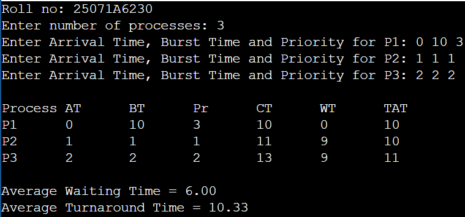

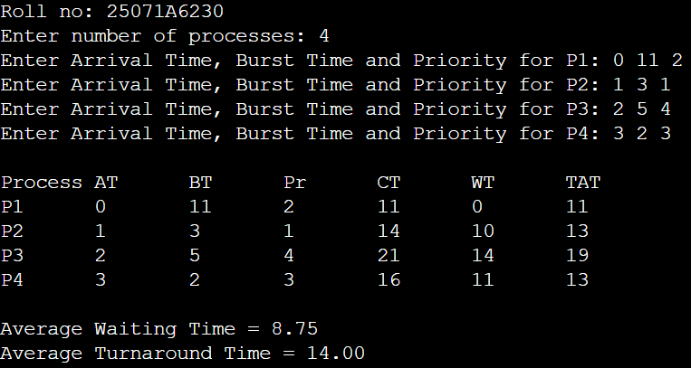

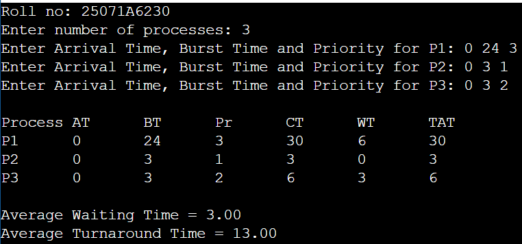

## Priority Scheduling — Preemptive

The program selects the arrived process with the lowest priority value and executes it for one time unit before reevaluating.

### Program

[`priority_preemptive.c`](experiments/02_priority_round_robin/src/priority_preemptive.c)

### Output / Test-case Snippets

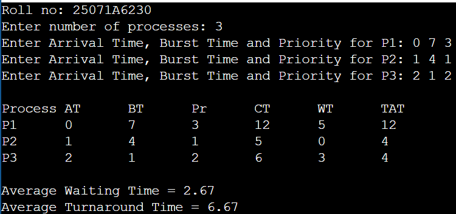

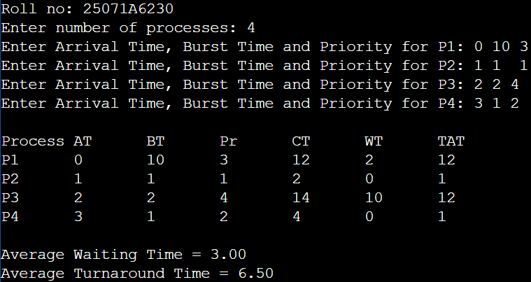

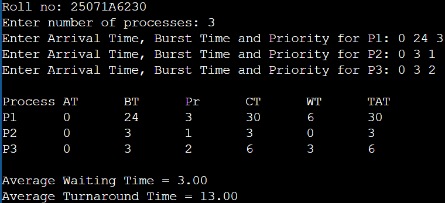

## Round Robin — Time Quantum 2

The record uses TQ = 2, remaining time, ready-queue processing, completion time, turnaround time and waiting time.

### Program

[`round_robin_tq2.c`](experiments/02_priority_round_robin/src/round_robin_tq2.c)

### Output / Test-case Snippets

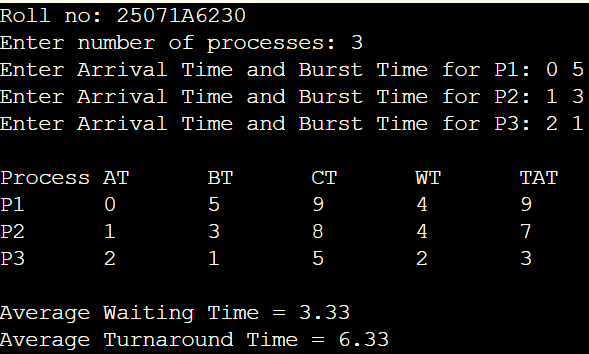

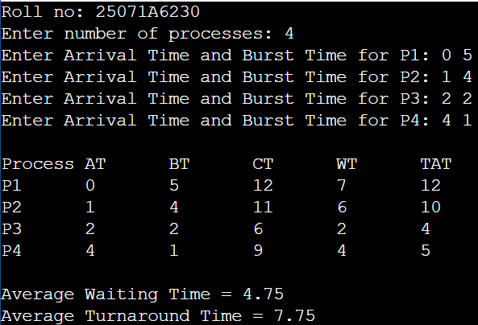

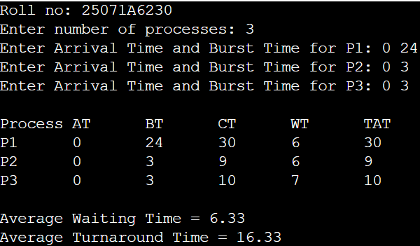

## Round Robin — Time Quantum 10

The same record structure is used with TQ = 10.

### Program

[`round_robin_tq10.c`](experiments/02_priority_round_robin/src/round_robin_tq10.c)

### Output / Test-case Snippets

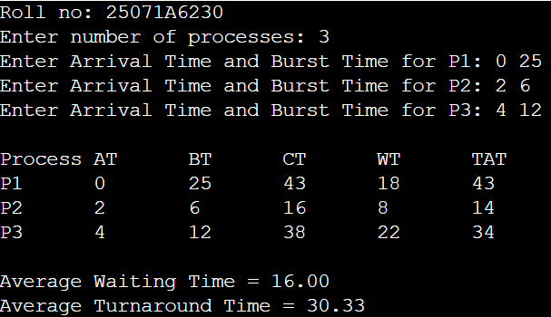

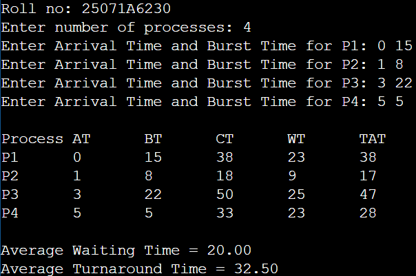

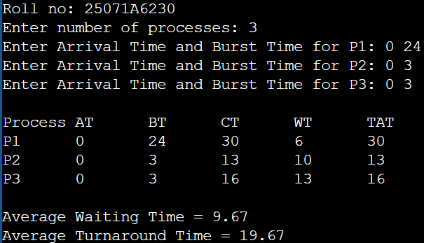

[Open Experiment 2 README](experiments/02_priority_round_robin/README.md)

---

# Experiment 3 — Banker’s Algorithm and Scheduling Analysis

**Date in record:** 23-07-2026

## Scheduling Analysis

The record includes an analysis of:

- FCFS — No Arrival
- FCFS — With Arrival
- SJF — Non-Preemptive
- SRTF — Preemptive
- Priority — Non-Preemptive
- Priority — Preemptive
- Round Robin — Q1
- Round Robin — Q2

### Analysis Chart Snippet

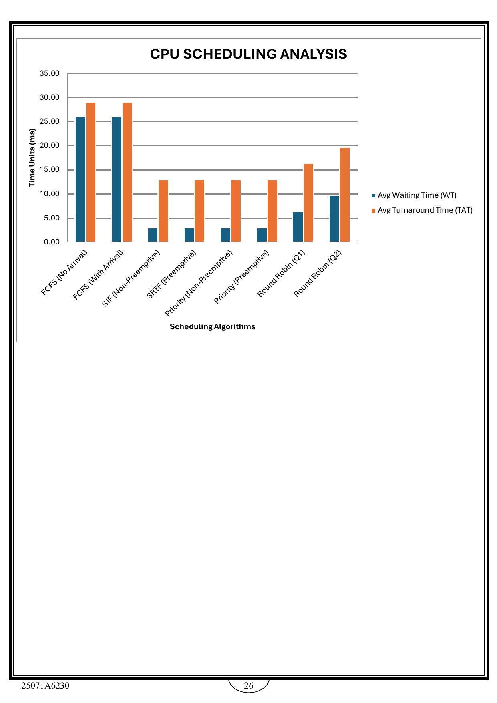

## Banker’s Algorithm

The record calculates `Need = Max − Allocation`, initializes `Work = Available`, repeatedly finds an unfinished process whose `Need ≤ Work`, adds its allocation back to Work, builds a safe sequence, and reports a safe or unsafe state.

### Program

[`bankers_algorithm.c`](experiments/03_banker_scheduling_analysis/src/bankers_algorithm.c)

### Output / Test-case Snippets

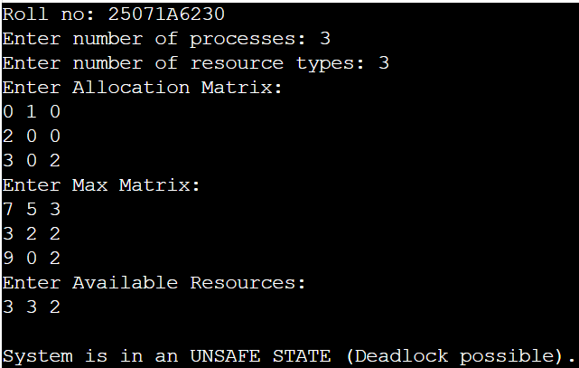

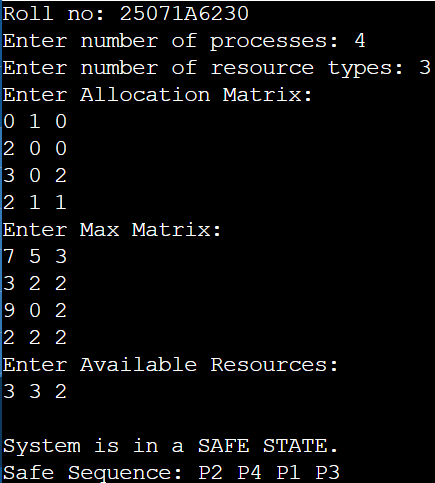

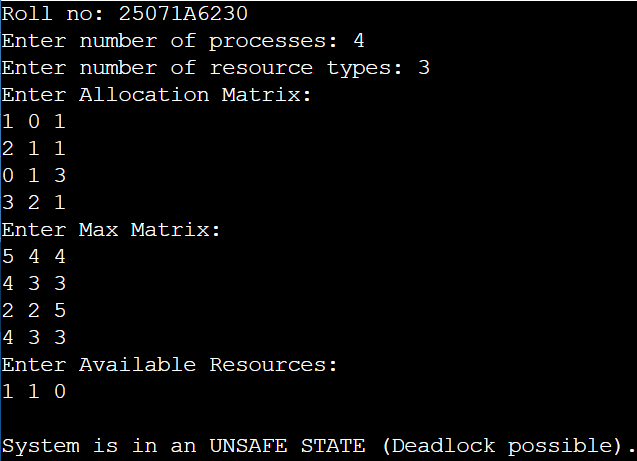

[Open Experiment 3 README](experiments/03_banker_scheduling_analysis/README.md)

---

# Experiment 4 — Fixed-Partition Memory Allocation

**Date in record:** 27-08-2026

The record covers First Fit, Worst Fit and Best Fit for fixed-partition memory allocation. Internal fragmentation is calculated as partition/block size minus process size.

## First Fit

[`first_fit.c`](experiments/04_memory_allocation/src/first_fit.c)

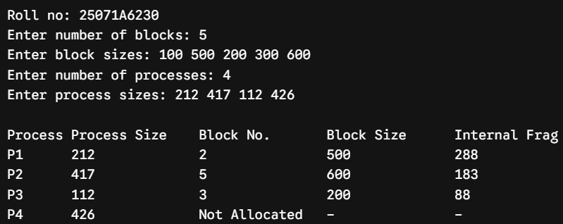

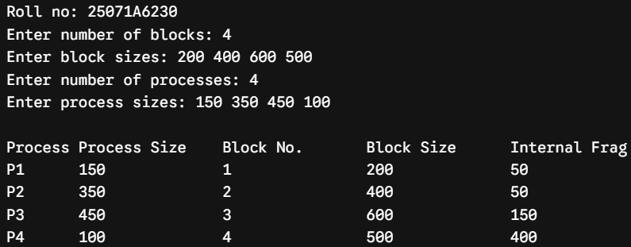

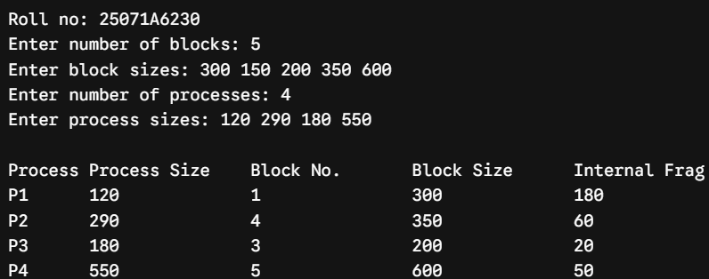

## Worst Fit

[`worst_fit.c`](experiments/04_memory_allocation/src/worst_fit.c)

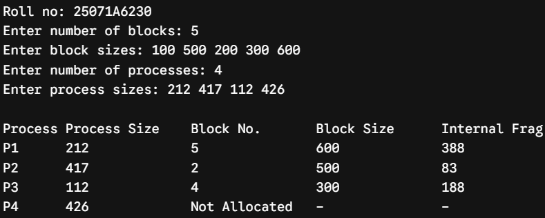

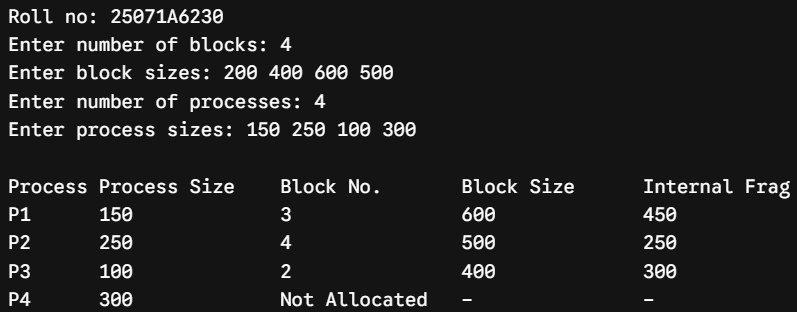

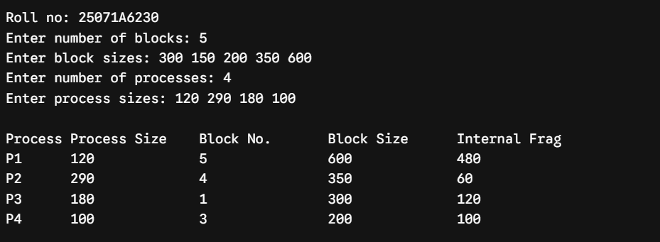

## Best Fit

[`best_fit.c`](experiments/04_memory_allocation/src/best_fit.c)

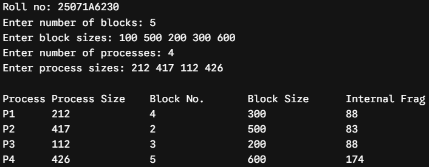

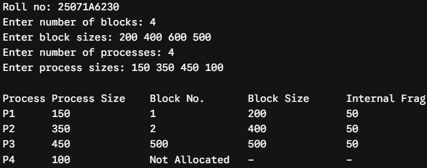

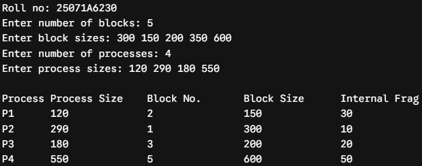

[Open Experiment 4 README](experiments/04_memory_allocation/README.md)

---

# Experiment 5 — Paging Technique of Memory Management

**Date in record:** 27-08-2026

The record calculates total frames, total pages, constructs a page table, splits a logical address into page number and offset, and calculates the physical address using the allocated frame.

### Program

[`paging_address_translation.c`](experiments/05_paging/src/paging_address_translation.c)

### Output / Test-case Snippets

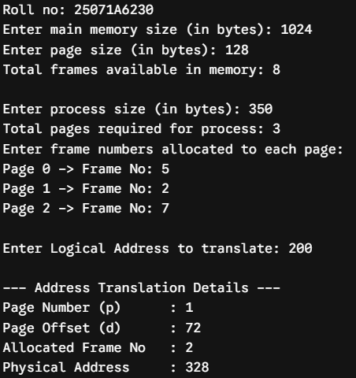

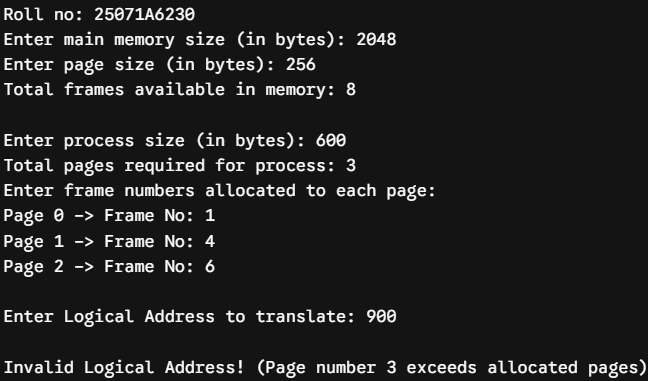

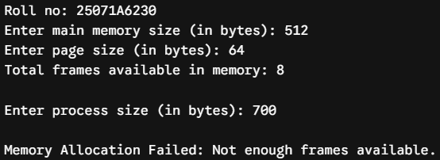

[Open Experiment 5 README](experiments/05_paging/README.md)

---

# Experiment 6 — Page Replacement Algorithms

**Date in record:** 08-10-2026

Aim: FIFO, LRU and Optimal page replacement.

- [`fifo.c`](experiments/06_page_replacement/src/fifo.c)
- [`lru.c`](experiments/06_page_replacement/src/lru.c)
- [`optimal.c`](experiments/06_page_replacement/src/optimal.c)
- [Experiment 6 README](experiments/06_page_replacement/README.md)

The supplied record has blank Testcases sections for these programs, so no output screenshots have been fabricated.

---

# Experiment 7 — Frame Allocation Methods

**Date in record:** 03-09-2026

The record contains minimum-number, equal, and proportional frame allocation methods.

## Minimum Number of Frames

[`minimum_frame_allocation.c`](experiments/07_frame_allocation/src/minimum_frame_allocation.c)

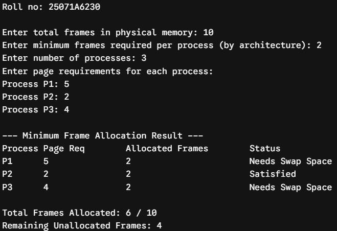

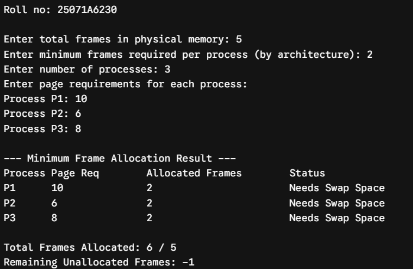

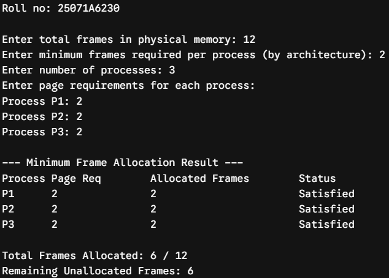

## Equal Allocation

[`equal_frame_allocation.c`](experiments/07_frame_allocation/src/equal_frame_allocation.c)

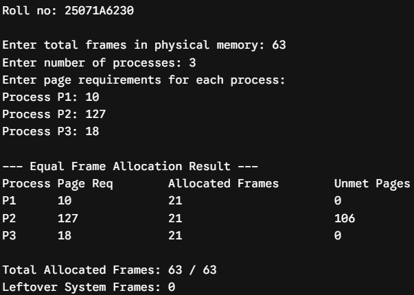

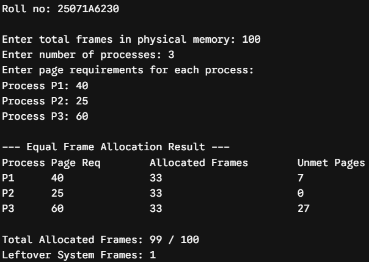


## Proportional Allocation

[`proportional_frame_allocation.c`](experiments/07_frame_allocation/src/proportional_frame_allocation.c)

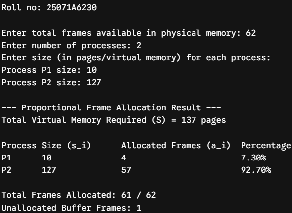

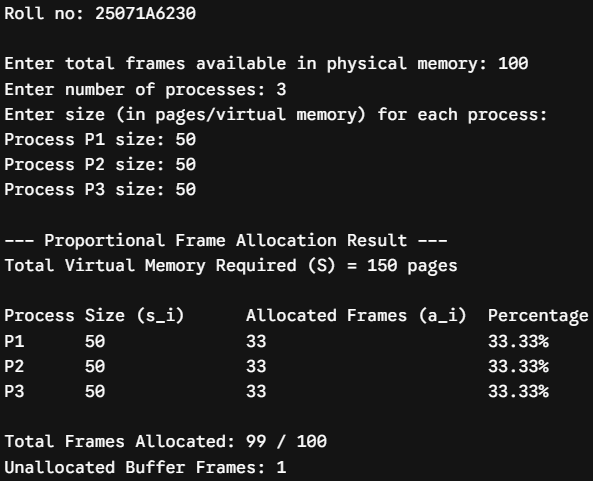


[Open Experiment 7 README](experiments/07_frame_allocation/README.md)

---

# Experiment 8 — Disk Scheduling: FCFS, SSTF and SCAN

**Date in record:** 10-09-2026

The record measures Total Head Movement (THM) and Average Seek Time.

## FCFS

[`disk_fcfs.c`](experiments/08_disk_scheduling/src/disk_fcfs.c)

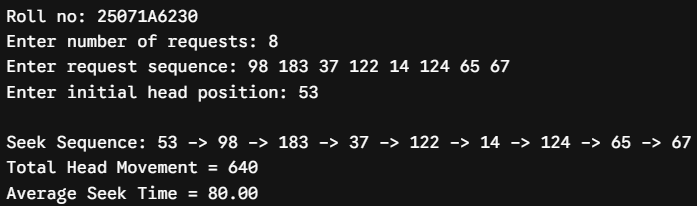

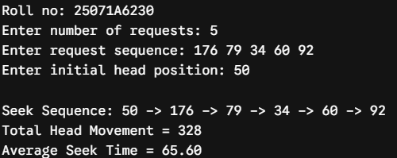

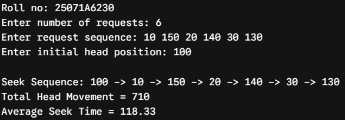

## SSTF

[`disk_sstf.c`](experiments/08_disk_scheduling/src/disk_sstf.c)

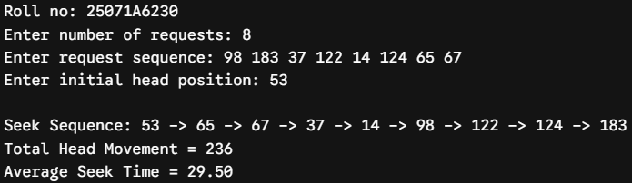

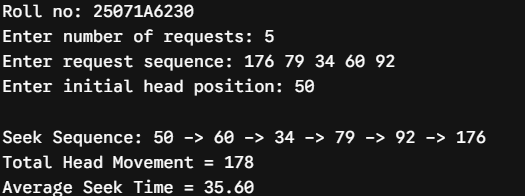

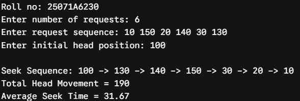

## SCAN

[`disk_scan.c`](experiments/08_disk_scheduling/src/disk_scan.c)

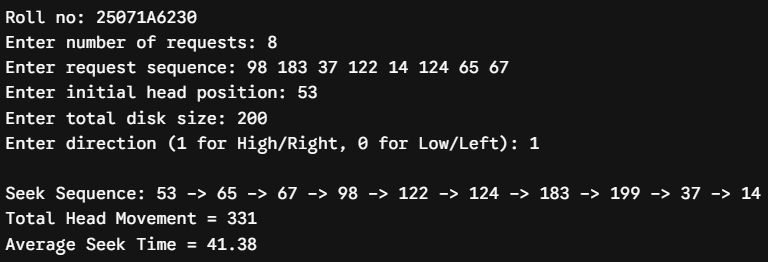

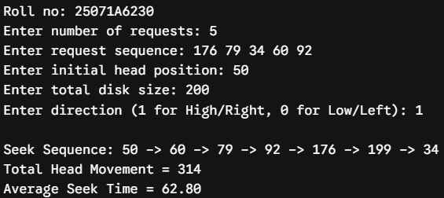

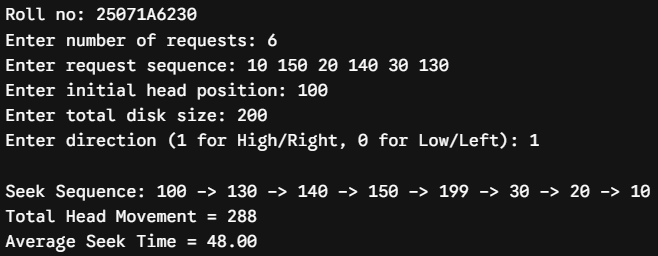

[Open Experiment 8 README](experiments/08_disk_scheduling/README.md)

---

# Experiment 9 — Disk Scheduling: C-SCAN, LOOK and C-LOOK

**Date in record:** 17-09-2026

The record covers circular SCAN, LOOK and C-LOOK style disk scheduling.

> **Record label note:** The supplied program pages are labeled `C) C-SCAN`, `C) LOOK`, and `C) C-LOOK`, even though the experiment aim lists C-SCAN, LOOK and C-LOOK as A/B/C items. The repository uses the algorithm names as filenames and preserves the source program text.

## C-SCAN

[`disk_cscan.c`](experiments/09_disk_scheduling/src/disk_cscan.c)

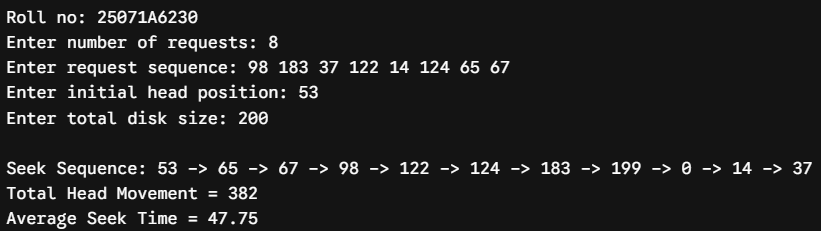

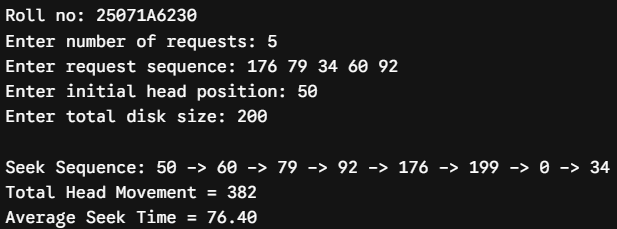

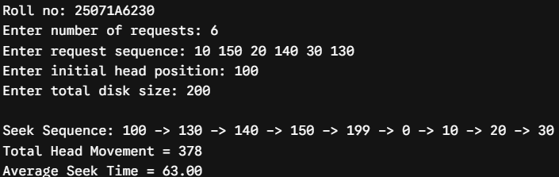

## LOOK

[`disk_look.c`](experiments/09_disk_scheduling/src/disk_look.c)

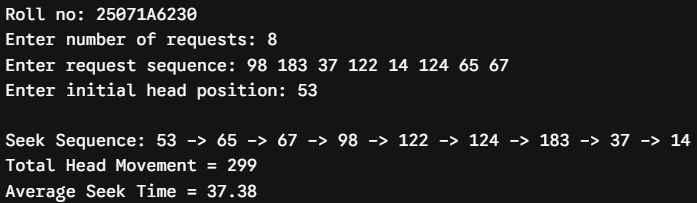

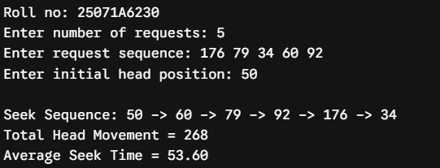

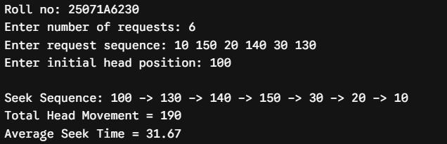

## C-LOOK

[`disk_clook.c`](experiments/09_disk_scheduling/src/disk_clook.c)


[Open Experiment 9 README](experiments/09_disk_scheduling/README.md)

---

# Running the Programs

The programs are standard C programs and can be compiled with GCC.

```bash
gcc -std=c11 program.c -o program
./program
```

On Windows with MinGW/GCC:

```powershell
gcc -std=c11 program.c -o program.exe
.\program.exe
```

Each source file retains the interactive input style shown in the laboratory record.

# Source Record

The original supplied files are retained under [`record/`](record/):

- [`os_record.pdf`](record/os_record.pdf)
- [`os_record.docx`](record/os_record.docx)

# Repository Notes

- All 25 C programs extracted from the supplied record are placed in `src/` folders.
- Output/test-case screenshots from the supplied record are preserved under `outputs/`.
- The scheduling-analysis chart is preserved as a page-rendered snippet under Experiment 3.
- The source record is included so the GitHub repository remains traceable to the original laboratory document.
- Experiment 6 is included from the latest supplied record; its three C programs are transcribed from the FIFO, LRU and Optimal program snippets.
