# Experiment 1 — FCFS and SJF Scheduling Algorithms

**Date:** 23-07-2026  
**Roll No.:** 25071A6230

## Aim

Write C programs for FCFS scheduling algorithm without arrival times and with arrival times, and SJF scheduling in non-preemptive and preemptive forms.

## Algorithms from the Record

### FCFS — Without Arrival Times
1. Start.
2. Input the number of processes (n).
3. Input the Arrival Time (AT) and Burst Time (BT) for each process.
4. Initialize `current_time = 0`, `total_wt = 0`, and `total_tat = 0`.
5. For each process, if `current_time < AT`, set `current_time = AT`.
6. Calculate `CT = current_time + BT`.
7. Calculate `TAT = CT − AT`.
8. Calculate `WT = TAT − BT`.
9. Update `current_time = CT`.
10. Calculate average WT and average TAT.
11. Display AT, BT, CT, WT, TAT, average WT and average TAT.
12. Stop.

### FCFS — With Arrival Times
The supplied record labels this section as “with arrival times” and gives the following algorithm: input `n`, input BT, initialize `WT[0] = 0`, calculate each WT using the previous process burst time, calculate `TAT = WT + BT`, calculate averages, display BT/WT/TAT and stop.

### SJF — Non-Preemptive
1. Input `n`, AT and BT.
2. Initialize `current_time = 0` and mark all processes unvisited.
3. Select an arrived process with the smallest BT.
4. If no process has arrived, increment `current_time`.
5. Otherwise execute the selected process, calculate CT/TAT/WT, update current time and mark it completed.
6. Calculate AWT and ATAT.
7. Display AT, BT, CT, WT, TAT, AWT and ATAT.

### SJF — Preemptive
1. Input `n`, AT and BT and set RT = BT.
2. Initialize `time = 0` and `completed = 0`.
3. Select the arrived process with the smallest RT.
4. If no process is ready, increment time.
5. Otherwise execute it for one time unit, decrement RT and increment time.
6. When RT becomes zero, calculate CT and mark the process completed.
7. Calculate TAT, WT, AWT and ATAT and display them.

## Source Files

- [`fcfs_without_arrival.c`](src/fcfs_without_arrival.c)
- [`fcfs_with_arrival.c`](src/fcfs_with_arrival.c)
- [`sjf_non_preemptive.c`](src/sjf_non_preemptive.c)
- [`sjf_preemptive_srtf.c`](src/sjf_preemptive_srtf.c)

## Output Snippets

### FCFS Without Arrival
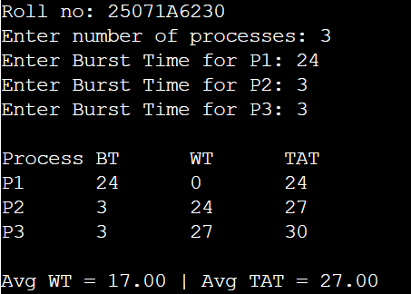
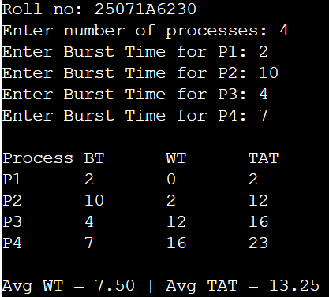
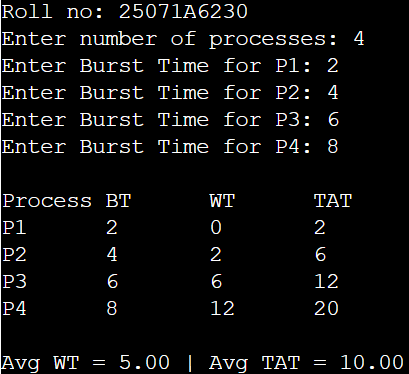

### FCFS With Arrival
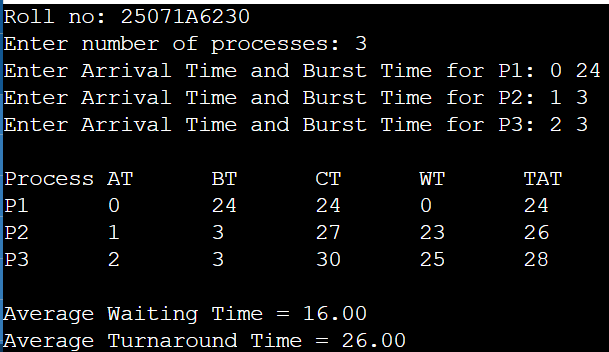
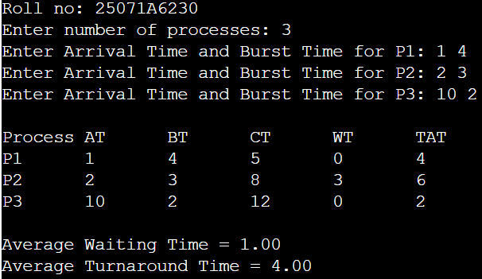
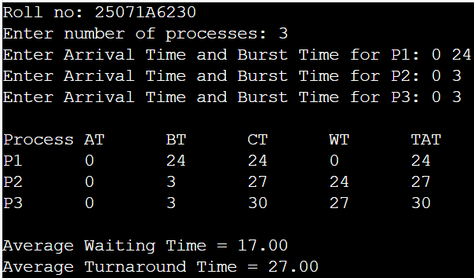

### SJF Non-Preemptive
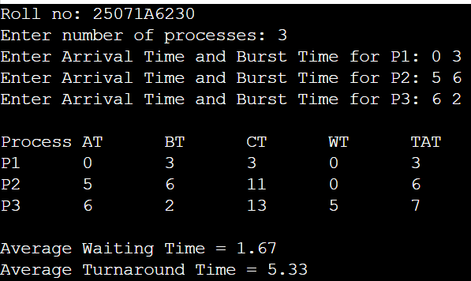
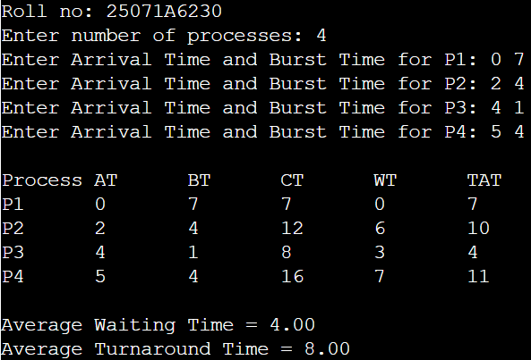
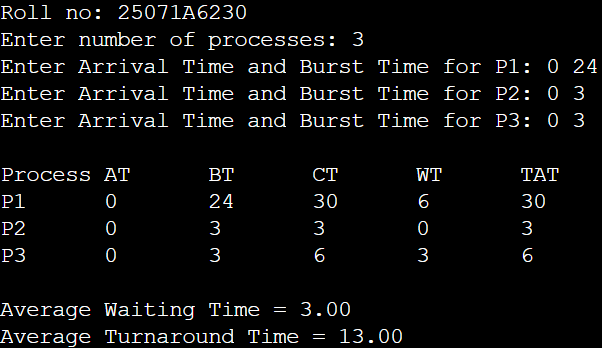

### SJF Preemptive / SRTF
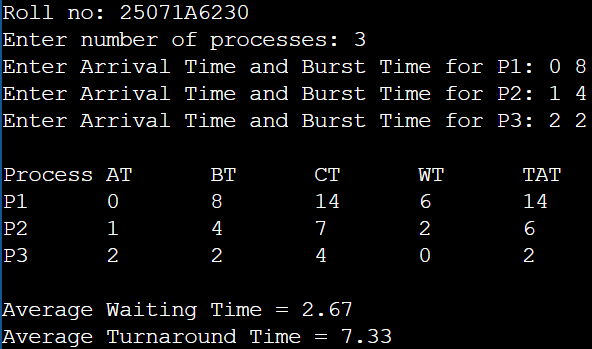
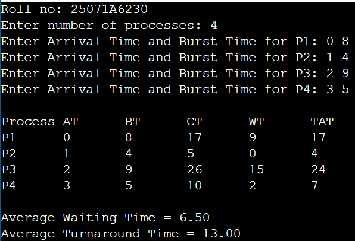
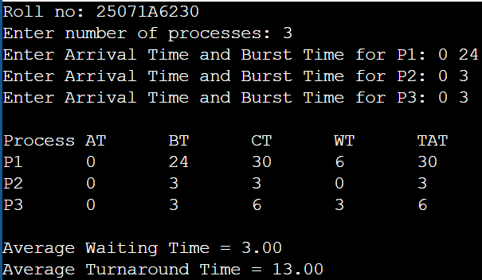
